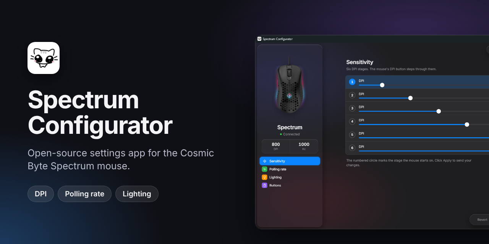
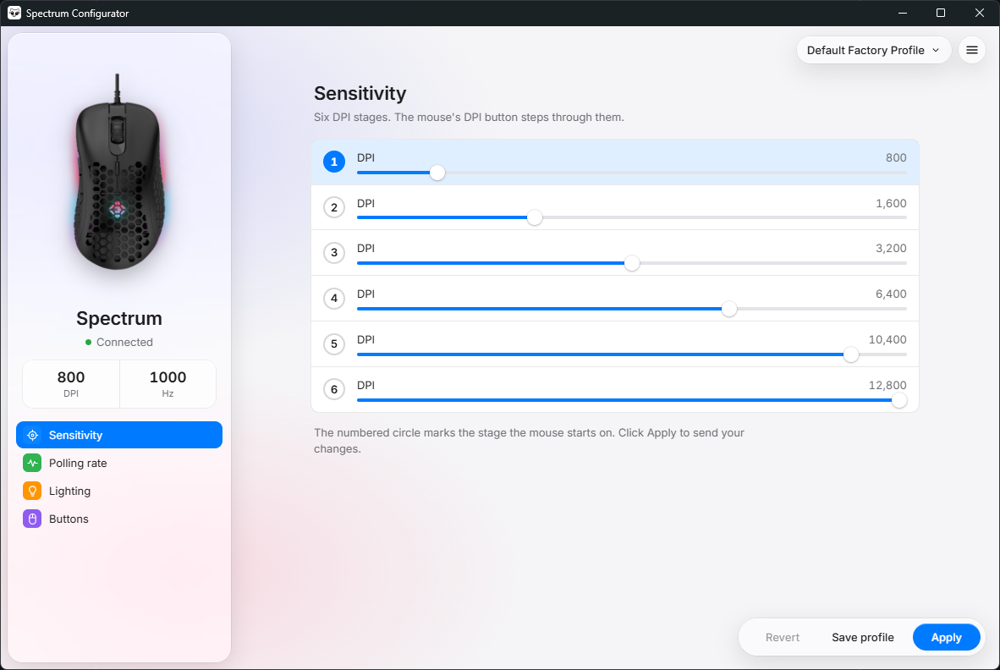
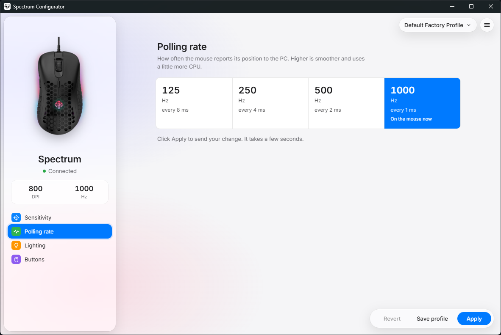
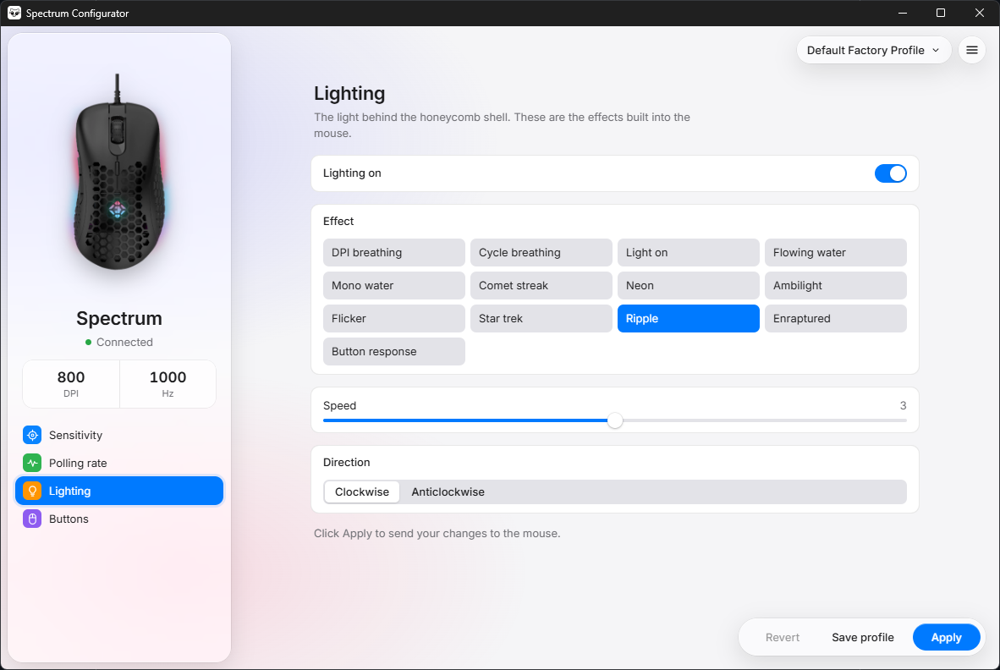

# Spectrum Configurator

[](LICENSE)
[](../../releases/latest)


An unofficial, open-source configuration app for the **Cosmic Byte Spectrum** wired gaming mouse. It replaces the vendor's Windows software with a small, fast app built with Tauri, React, TypeScript and Rust.

This project is not affiliated with or endorsed by Cosmic Byte. Product names are used only to say which mouse the app works with.

**[Download the latest installer](../../releases/latest)**

<p align="center">
  
</p>

<p align="center">
  
  
  
</p>

## What it does

- **Sensitivity:** six DPI stages from 200 to 12,800. The mouse's DPI button steps through them.
- **Polling rate:** 125, 250, 500 or 1000 Hz.
- **Lighting:** the mouse's built-in effects, with brightness, speed and direction where the effect supports them.
- **Profiles:** save, rename, export and import settings as JSON files.
- **Demo mode:** no mouse? The app switches to a demo mouse automatically so you can try it, and switches back to your real mouse as soon as it is plugged in.
- **Light and dark themes**, following the Appearance setting in the menu.

## Install

1. Download the `.msi` from the [latest release](../../releases/latest).
2. Run it. The installer asks where to install and whether to add desktop and Start menu shortcuts.
3. Close the vendor app if it is running, then open Spectrum Configurator.

Windows 10 and 11 are supported. The installer is not code-signed, so Windows SmartScreen may show a blue "Windows protected your PC" window. Click **More info**, then **Run anyway**.

## Using it

Change what you want, then click **Apply**. Nothing is sent to the mouse until you do. **Revert** undoes your unsaved changes, and **Save profile** keeps your settings so you can load them later from the profile menu at the top right.

Applying takes a few seconds. Do not unplug the mouse while it runs.

## How Apply works

The mouse keeps all of its settings in one block of flash memory. Apply rewrites that whole block, the same way the vendor app does. Before and after writing, the app reads the mouse's status and stops at the first sign of a mismatch. Settings you have not changed are written back as the mouse's factory defaults, not as what was on the mouse before.

Apply refuses to run while the vendor app is open, because both talk to the same mouse.

## Troubleshooting

- **The app says demo mode but the mouse is plugged in.** Check the cable and try another USB port. The app looks for a Cosmic Byte Spectrum (see Hardware below) and switches over within a couple of seconds.
- **Apply says it was refused.** Close the vendor app and try again.
- **Something else went wrong.** Open an [issue](../../issues/new/choose) with your Windows version and what you clicked.

## Roadmap

- Buttons and macros (the tab is there but not built yet)
- A Linux version

## Build from source

You need [Node.js](https://nodejs.org/) 20 or newer, [Rust](https://rustup.rs/) (stable) and the [Tauri prerequisites](https://tauri.app/start/prerequisites/) for your system.

```powershell
npm install
npm run tauri dev      # run the app
npm test               # TypeScript tests
cargo test --manifest-path crates/spectrum-protocol/Cargo.toml   # protocol tests
npm run tauri build    # build the installer
```

## Project layout

| Folder | What it holds |
| :--- | :--- |
| `src/` | The React interface, profiles and the app-side logic |
| `src-tauri/` | The Tauri shell, USB access and the installer definition |
| `crates/spectrum-protocol/` | The mouse protocol and its safety checks, with tests |
| `tests/` | TypeScript tests |
| `docs/` | Screenshots used in this README |

## Hardware

VID `0x30FA`, PID `0x1440`. Settings are sent as HID feature report `0x07` on the vendor interface (usage page `0xFF01`). The app never opens the mouse, keyboard or media interfaces.

## License

[MIT](LICENSE).

## Acknowledgements

Built with help from [Claude](https://claude.ai), an AI assistant made by Anthropic.
